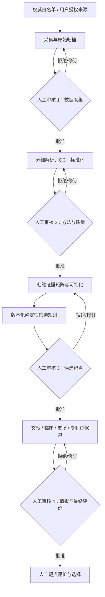

# MedSCALE 权威证据研究执行平台 V2

> 日期：2026-06-19
> 状态：Accepted for planning
> 级别：CRITICAL
> 适用范围：疾病无关、人类研究优先、本地/内网部署

## 1. 系统定位

MedSCALE V2 是一个确定性、可审计、强制人工审核的医学研究执行平台。它负责：

1. 从批准的数据源准确下载真实数据。
2. 保存原始数据及完整出处。
3. 对不同来源的数据分别质控、标准化和归一化。
4. 生成可追溯的可视化和候选靶点证据。
5. 收集文献、临床、市场和专利事实。
6. 在每个阶段等待研究人员审核签署。

系统不负责替代研究人员推理，不自动形成靶点推荐、临床结论、市场判断、专利法律
意见或投资建议。

## 2. 不可妥协原则

- **真实数据**：搜索命中、网页摘要、缓存标签或模型生成文本不能冒充原始数据。
- **完整溯源**：每个文件记录稳定标识、URL/API、检索式、获取时间、许可和 SHA-256。
- **原始数据不可变**：原始层只读；修复解析器时重新生成标准化层和分析层。
- **分维处理**：七维组学保持各自量纲、质量模型和方法卡。
- **后期整合**：跨维比较方向、一致性、质量、冲突和缺失，不强行混合原始量纲。
- **确定性筛选**：规则、阈值、权重、排除条件和软件版本全部版本化。
- **人工放行**：采集、标准化、筛选和情报分析均须签署，未签署不能继续。
- **失败关闭**：来源失效、格式漂移、许可过期、对照失败或证据不足时阻断。
- **人类证据优先**：动物、细胞系和类器官证据单独标记。
- **LLM 最小权限**：仅辅助检索扩展和逐段翻译，不能评分、筛选或生成研究结论。

## 3. 需求摘要

### 3.1 功能需求

- 疾病无关的研究项目和数据源适配器框架。
- 七维组学：转录组、基因组变异、蛋白组、功能依赖、表观组、单细胞、空间组学。
- 文献、临床、市场和专利四类情报证据包。
- 开放数据与用户自有授权数据并存。
- 权威来源白名单和适配器准入流程。
- 原始、标准化、分析三层数据模型。
- 统一实体标识和可版本化映射。
- 证据矩阵、质量图、单维图和跨维图。
- 可配置确定性筛选规则。
- 双重阳性对照：适配器固定基准集和项目自定义对照。
- 四阶段强制人工审核状态机。
- 审计时间线、漂移监控和可复现性验证。

### 3.2 非功能需求

- **部署**：本地或内网优先，基础流程不依赖外部 LLM。
- **数据边界**：授权数据、密钥和中间产物不得离开用户环境。
- **可复现性**：相同输入、容器/环境、参数和随机种子产生一致结果清单。
- **可审计性**：任意结果可反向定位到原始文件、代码版本和人工签署。
- **可恢复性**：下载支持断点续传；每阶段可从已批准 checkpoint 恢复。
- **可扩展性**：新增数据源通过插件式适配器接入，但必须通过准入门禁。
- **安全**：密钥使用本地安全存储；授权数据按项目和许可策略隔离。

### 3.3 术语、检索与循证方法补充

- 建立版本化 Terminology Registry；按实体域选择 HGNC/Ensembl、MONDO/MeSH/HPO、
  UBERON、RxNorm 等规范 ID。
- UMLS、SNOMED CT 和授权全文库必须完成许可准入，不作为默认依赖。
- 原文语言索引物理隔离；翻译文本不得替代原文证据。
- BM25、受控词表、向量和实体扩展均是候选召回通道，权重和 Top-K 必须经冻结基准验证。
- 研究设计、风险偏倚、证据确定性和适用性分开记录；禁止把自定义数字分冒充 GRADE。
- 正式报告使用 claim ledger，逐声明绑定原文 locator。
- 知识图谱是派生索引而非真值库，图谱缺失不得解释为关系不存在。
- 医学证据与商业事实物理隔离，外部 API 出站内容形成独立审批 manifest。
- 详细审计见 `MEDICAL_AI_GUIDE_EVIDENCE_AUDIT_2026-06-19.md` 和 ADR-0006。

## 4. 总体架构



## 5. 组件边界

### 5.1 Source Registry

管理来源白名单、许可、版本、认证方式、稳定标识、速率限制、数据维度和允许用途。
只有 `approved` 状态的来源才能进入项目工作流。

### 5.2 Adapter Runtime

每个适配器必须实现：

```text
discover → resolve stable IDs → download → verify checksum
→ inventory files → validate format → run fixed control → emit manifest
```

适配器不得只返回摘要。若数据库仅提供处理后数据，manifest 必须明确标记
`artifact_level=processed`，不能称为原始测序数据。

### 5.3 Three-Layer Data Store

```text
raw/          原始响应、原始文件、许可和下载清单，只读
normalized/   解析、QC、映射、标准化后的分维数据
analysis/     统计结果、图表、证据矩阵和候选列表，可重建
```

元数据目录保存数据集、实体、运行、方法卡、审核、许可和血缘关系；大文件保存在本地对象
目录或兼容 S3 的内网对象存储。V1 不要求云服务。

### 5.4 Normalization Engine

每个维度独立提供：

- 输入 schema 和量纲识别。
- 样本与特征 QC。
- 标识、参考基因组和本体映射。
- 归一化或标准化算法。
- 批次诊断和缺失值策略。
- 方法卡和前后诊断图。
- 固定阳性/阴性对照。

### 5.5 Evidence Matrix Engine

以“基因 × 证据单元”存储：

- 来源、队列、数据维度和证据类型。
- 样本量、效应量、置信区间和校正后显著性。
- 支持、反对、冲突、缺失或不适用。
- 质量等级和人工审核状态。
- 原始、标准化和分析产物 locator。

### 5.6 Deterministic Rule Engine

规则按以下顺序执行：

```text
硬性排除 → 单维阈值 → 独立来源数量 → 方向一致性
→ 冲突检查 → 正常组织/安全性过滤 → 候选清单
```

系统输出入选和排除原因，不输出不可解释的总分，不将缺失视为阴性。

### 5.7 Intelligence Packs

每个获批靶点分别生成：

- 文献证据包。
- 临床与监管证据包。
- 市场事实证据包。
- 专利族与法律状态证据包。

专利模块不输出 FTO 或有效性法律结论；市场模块不将第三方预测当成官方事实。

文献证据包额外要求：

- 原始语言记录优先保存，翻译单独成层。
- 研究设计、偏倚风险、证据确定性和问题适用性分栏。
- 不使用期刊影响因子或引用量自动提高证据确定性。
- 每条陈述必须进入 claim ledger；无原文定位则阻断正式交付。

### 5.8 Review and Audit Service

状态机：

```text
DRAFT → RUNNING → REVIEW_REQUIRED
                    ├─ APPROVED → next stage
                    ├─ REJECTED → TERMINATED
                    └─ REVISION_REQUIRED → rerun
```

审核记录包括审核人、角色、时间、输入/输出哈希、规则版本、结论、备注和签名。上游产物
或规则变化会自动使下游批准失效。

## 6. 初始权威来源矩阵

下表是 V1 候选白名单，不代表自动批准。每个来源仍须完成许可、API/下载验证、基准集和
格式漂移测试。

| 领域 | A 级核心候选 | 补充/授权候选 | 用途限制 |
| --- | --- | --- | --- |
| 转录组 | NCBI GEO、GTEx、EMBL-EBI Expression Atlas | 用户授权队列 | 跨研究比较效应量，不直接拼表达值 |
| 基因组变异 | NCI GDC、gnomAD | ICGC ARGO、用户授权 WGS/WES | 统一参考基因组和变异表示 |
| 蛋白组 | NCI PDC/CPTAC、PRIDE | 用户授权蛋白组 | 平台和批次独立处理 |
| 功能依赖 | Broad DepMap、Sanger Project Score | 用户授权筛选 | 保留发布版本和模型校正 |
| 表观组 | ENCODE、GEO/SRA | 用户授权 ATAC/ChIP/甲基化 | 实验类型分开比较 |
| 单细胞 | Human Cell Atlas、CELLxGENE Discover | GEO/SRA、用户授权 | 保留 raw UMI，跨队列用 pseudobulk |
| 空间组学 | HuBMAP、GEO/SRA | 用户授权空间数据 | 保留坐标、切片和图像 |
| 文献 | PubMed、Europe PMC | 授权全文库 | 逐条绑定 PMID/DOI 和原文定位 |
| 临床 | ClinicalTrials.gov、WHO ICTRP | 各国注册平台 | 以注册号和更新时间追踪 |
| 监管 | FDA、EMA 等官方记录 | 地区监管机构 | 批准事实与预测分离 |
| 专利 | WIPO PATENTSCOPE、EPO Espacenet、USPTO | Derwent 等用户授权库 | 不自动给出法律意见 |
| 市场 | SEC/交易所披露、公司财报和官方公告 | Cortellis/GlobalData 等授权库 | 官方事实与商业估计分层 |

## 7. 七维标准化策略

### 转录组

- RNA-seq 保留 raw counts；研究内使用版本化 size factor/TMM 等方法。
- 芯片按平台使用经验证的 RMA 或平台指定流程。
- 跨研究使用效应量、方向和置信区间，不直接合并表达量。

### 基因组变异

- 统一 GRCh 版本、左对齐、最简表示、等位基因方向和注释版本。
- 保留原始 VCF 与规范化 VCF；不同检测流程分别标记。

### 蛋白组

- 按质谱平台、定量方法和批次独立处理。
- 记录 log 转换、样本内校正、批次诊断和缺失机制。

### 功能依赖

- 保留数据库发布的原始和校正依赖分数。
- 细胞系实体、组织来源和模型版本必须可追溯。

### 表观组

- 统一参考坐标、signal/peak 定义和实验类型。
- ATAC、ChIP、甲基化等不能作为同一数值层直接融合。

### 单细胞

- 保存 raw UMI、细胞 QC、双细胞检测、批次和细胞类型映射。
- 跨队列优先使用样本级 pseudobulk 和分层统计。

### 空间组学

- 保留原始图像、空间坐标、切片、spot/cell 层级和组织注释。
- 只在同平台和同分析层级内归一化。

## 8. 可视化契约

### 数据质量层

- 原始与标准化分布。
- 样本量、缺失率、异常值和重复样本。
- 批次效应与映射率。
- 阳性/阴性对照和漂移图。

### 单维证据层

- 火山图、森林图和表达分布。
- 变异景观、蛋白差异和依赖性分布。
- 表观信号、单细胞细胞类型图和空间表达图。

### 跨维证据层

- 证据方向热图。
- 来源覆盖与缺失矩阵。
- 冲突矩阵。
- 每个候选的证据 drill-down。

图表数据必须能下载，并包含输入产物、分析运行和绘图代码 locator。

## 9. 数据血缘与 manifest

每个产物至少包含：

```json
{
  "artifact_id": "stable-local-id",
  "source_id": "approved-source-version",
  "stable_record_ids": [],
  "query": {},
  "retrieved_at": "ISO-8601",
  "license": {},
  "sha256": "...",
  "size_bytes": 0,
  "media_type": "...",
  "parser_version": "...",
  "method_card_id": "...",
  "parents": [],
  "review_status": "review_required"
}
```

## 10. 监控和阳性对照

### 四层监控

1. 来源健康：连接、认证、许可、版本和 schema。
2. 数据质量：样本量、缺失率、重复率、映射率和批次效应。
3. 双重对照：适配器固定基准和项目自定义对照。
4. 可复现性：输入、环境、参数、随机种子和输出哈希。

### 失败处理

| 故障 | 系统行为 |
| --- | --- |
| 下载不完整或哈希不符 | 拒绝进入 raw 层 |
| schema 漂移 | 隔离产物并停用适配器版本 |
| 阳性对照超容差 | 阻断该维度和下游 |
| 许可过期 | 禁止继续读取、计算或导出 |
| 实体映射不确定 | 进入人工映射队列 |
| 多来源冲突 | 保留各结果并标记冲突 |
| LLM 缺失原文绑定 | 丢弃输出 |

## 11. LLM 使用边界

允许：

- 扩展检索词，供人工确认后执行。
- 翻译已获取文本。
- 为原文段落建立逐条译文。

每条输出必须记录来源 ID、原文定位、内容哈希、模型、提示词、时间和译文。不允许：

- 生成或填补实验数据。
- 自动评价证据质量或选择靶点。
- 自动形成疗效、市场、专利或投资结论。
- 在无原文定位时进入正式证据包。
- 自动生成 PICO、病例/对照或阳性对照后直接执行；只能生成待人工确认草案。
- 使用知识图谱缺失关系作为否定事实。
- 自动执行创新方向、投资评分或商业推荐。

## 12. 实施切片

1. 治理底座：本地存储、元数据目录、统一标识、审核和权限。
2. 适配框架：白名单、许可、下载、manifest、漂移和固定对照。
3. 七维组学：每维至少两个通过准入的来源和方法卡。
4. 证据矩阵：后期整合、可视化、冲突和确定性规则。
5. 情报链路：文献、临床、监管、市场和专利。
6. 研究工作台：四次签署、审计、监控和项目阳性对照。

## 13. 验收标准

- 每个原始文件都有来源、许可、稳定 ID、获取时间和 SHA-256。
- 七维各有两个批准来源；不足时明确阻断。
- 每个转换可查看算法、参数、软件版本和前后诊断图。
- 任意候选基因可反向定位至原始记录。
- 候选列表同时解释入选、排除、冲突和缺失。
- 四个审核点无法绕过；上游变化使下游签署失效。
- 固定和项目阳性对照均通过；故意破坏数据时必须阻断。
- 文献、临床、专利和市场事实均能定位原文。
- 授权数据不离开本地，也不进入公开交付物。
- LLM 关闭后，确定性研究流程仍可运行。
- 相同输入、版本和参数可重建相同产物清单。
- 系统不自动输出“推荐靶点”结论。

## 14. 官方参考入口

- NCBI GEO: https://www.ncbi.nlm.nih.gov/geo/
- NCI GDC: https://portal.gdc.cancer.gov/
- GTEx: https://gtexportal.org/
- NCI PDC: https://proteomic.datacommons.cancer.gov/pdc/
- PRIDE: https://www.ebi.ac.uk/pride/
- DepMap: https://depmap.org/portal/
- Project Score: https://score.depmap.sanger.ac.uk/
- ENCODE: https://www.encodeproject.org/
- Human Cell Atlas: https://data.humancellatlas.org/
- CELLxGENE Discover: https://cellxgene.cziscience.com/
- HuBMAP: https://portal.hubmapconsortium.org/
- PubMed: https://pubmed.ncbi.nlm.nih.gov/
- Europe PMC: https://europepmc.org/
- ClinicalTrials.gov: https://clinicaltrials.gov/
- WHO ICTRP: https://trialsearch.who.int/
- WIPO PATENTSCOPE: https://patentscope.wipo.int/
- EPO Espacenet: https://worldwide.espacenet.com/
- USPTO: https://www.uspto.gov/patents/search
- FDA Drugs@FDA: https://www.accessdata.fda.gov/scripts/cder/daf/
- EMA medicines: https://www.ema.europa.eu/en/medicines
- SEC EDGAR: https://www.sec.gov/edgar/search/
